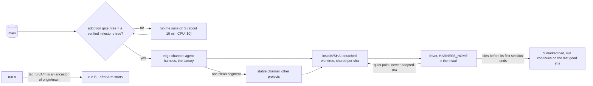

# Iteration 8 — From unattended nights to a harness that improves itself

**Dates:** 2026-10-27 → in progress. Written 2026-10-29 at 12:35 EDT. At that point the reliability run
`agent-harness-2026-10-29-2` is running again (4/23, two lanes, started 2 min before), and the self-modification design
below is a proposal I haven't chosen an approach for.
**Sessions:** three harness runs and five interactive sessions:
- the status-UX spec session (10-27 morning, PR #38);
- the decision answers (10-28, PR #44);
- the spec session for the unattended night and reliability, with the timeout measurements (10-28 → 10-29 01:17, PR #47);
- the two sessions that helped on the morning of 10-29 (the hiccups, PR #50);
- the design session on stable self-modification (10-29 late morning, no PR yet).

**Plan of record:**
- `docs/specs/2026-10-27-status-ux.md` (U1–U3);
- `docs/specs/2026-10-29-unattended-night.md` (N1, N2);
- `docs/specs/2026-10-28-reliability.md` (R1–R4);
- decisions `2026-10-27-read-views`, `2026-10-27-needs-record`, `2026-10-28-show`, `2026-10-27-same-project-starts`,
  `2026-10-29-rerun-guard`, `2026-10-29-conflict-resolution`, `2026-10-29-check-timeout-25m`;
- the morning's account: [`runs/2026-10-29-hiccups.md`](../runs/2026-10-29-hiccups.md).

## Context
Iteration 7 closed with lanes, the split suite and the memory model on `main`, all built and merged by the harness
(17/17, 12/12 and 23/23). The harness could now run a night by itself. What still cost me was every place it stopped
and waited, and how hard it was to see that it was waiting. On 10-27 I listed what I saw
(`docs/specs/2026-10-27-status-ux.md`, *What Michael saw*):
- `harness status` printed every run ever: **24 runs, 105 lines**, with log-tail internals as if they were state.
- `harness parked` printed `nothing parked` while **two runs were blocked on me**. It read one file, and most stop
  paths never wrote to it.
- A `main` conflict with a run branch was one log line, so I learnt two runs had collided only at merge time.
- Questions said "the decision file" with no path, branch or line.
- The memory run and the lanes continuation had built at once on 10-26, both rewriting `lib/driver.sh`, with no
  warning. A plain `harness start` checked only `MAX_PARALLEL_RUNS`, never the project.

## Trigger
Two asks, a day apart.
1. **10-27: "what needs me" should be one screen.** The spec's goal: I type `harness status` and see what needs me,
   what is running, what is queued and what finished, with a footer for the rest.
2. **10-29: conflicts without me.** "I want my agent to be able to handle merge conflicts like this without needing my
   approval", with the guard in place "before the night starts" (quoted in `docs/specs/2026-10-29-unattended-night.md`,
   *Source*). The flaky checks of the 10-26 and 10-28 runs were the other stop that didn't need me.

**My expectation going in:** once stops were visible and the two mechanical ones were gone, a chain of runs could
improve the harness overnight with no human step between them.

## Design, in three steps
### 1. Make every stop visible (U1–U3, run `agent-harness-2026-10-28`)
- **U1 read views.** Every read command (`status`, `queue list`, `needs`, `report`, `trends`, `gc --dry-run`) renders
  through one formatter, `lib/view.mjs`: sections, aligned columns, a glyph set with an ASCII fallback, colour on a
  TTY only. `status` shows NEEDS YOU, RUNNING, QUEUED and FINISHED. Conventions borrowed from `docker ps`, `gh run
  list`, `kubectl get`, `git status` and `systemctl`.
- **U2 the needs record.** Every path that stops for me writes one structured record with a card: what is blocked and
  what waiting costs, why, where (paths with lines, commit, URL), options with a recommendation, the exact commands.
- **U3 `harness show <run>`**, project names instead of paths, a record that survives gc, and **same-project starts**:
  a plain start or continue queues behind a live run of its project, and overlapping changes are named, never held.

### 2. Remove the stops that don't need me (N1, N2, run `agent-harness-2026-10-29`)
- **N1 the rerun guard.** A red full suite is rerun once. A red that passes the second time is green, named and
  counted (`Flakes` row in the report). A red that fails twice is red as before. Never quarantined.
- **N2 conflict resolution, in two layers.** Layer 1 is a merge driver for sorted one-per-line files
  (`tests/fixtures/check-names.txt`, where two lanes always collide). Layer 2 is one `resolve` session (Opus, 60 turns,
  $5, 30 min, at most 3 per milestone) for what's left. Either way the merged tree goes through the verify gate that
  already existed, so **what lands on `main` is still byte for byte what was verified**.
- **N1 before N2, in series on purpose.** The run was built by a harness that couldn't resolve conflicts yet, so two
  lanes would have stopped it.

### 3. Test it on two lanes (R1–R4, run `agent-harness-2026-10-29-2`)
Flakes fixed at their cause, journal entries that survive, the lanes review's leftovers, and questions that wait in one
place. R1, R2 and R3 run side by side on purpose: **the first real two-lane night, on a harness that resolves its own
conflicts.**

The spec says why these were two runs (`docs/specs/2026-10-28-reliability.md`, *Why two runs*): the harness that
judges a run is the live checkout, and the queue runner syncs it only between runs. So what protects a night has to
be merged before the night starts. The plan: N run first, the runner syncs, then the reliability run starts on a
harness with N1 and N2.

### Before the night: measure the timeout
`CHECK_TIMEOUT` was 15 min. Measured on 10-29 00:05–01:00, the full 859-check suite:

| Form | Wall | Failures |
|---|---|---|
| one suite alone, `TEST_JOBS=4` | 601 s | 1 |
| two suites at once (two lanes), `TEST_JOBS=4` each | 857 s each, load 9–10 | 0 |
| two suites at once, `TEST_JOBS=2` each | 1,172 s and 1,210 s | 2 |

Two lanes left 43 s of the 15 minutes. I set `CHECK_TIMEOUT=25m` for this repo only and left `TEST_JOBS` alone
(`decisions/2026-10-29-check-timeout-25m`).

## Evidence
| Run | Window (EDT) | Result | Spend · per feature | Wall · sessions | First-attempt · verify-fail | Tests |
|---|---|---|---|---|---|---|
| status UX `…-2026-10-28` | 10-28 01:12 → 22:39 | **24/24**, U1 #42 (08:30), U2 #43 (15:52), U3 #45 (22:38) | $139.12 · $5.80 | 21.46 h · 30 (1 refused by a limit) | 0.96 · 0.00 | 602 → 859 |
| unattended night `…-2026-10-29` | 10-29 01:19 → 11:20, 1 continuation | **11/11**, N1 #48 (05:21), N2 #51 (11:19) | $54.36 · $4.94 | 8.49 h · 21 | 0.82 · 0.08 (rework N1-03, N2-02) | 859 → 925 |
| reliability `…-2026-10-29-2` | 10-29 08:49 → stopped, record #53 (11:37); running again at 12:33 | **4/23**, 0 verified, 0 merged | $18.67 · $4.67 | 2.8 h · 8 | 0.60 · – | 886 → 900 |

- **Lanes in use.** Status UX: at most 1 lane open (21.11 lane hours in 21.46 h). Unattended night: at most 2, but
  8.12 lane hours in 8.49 h, so mostly one, as designed. Reliability: **4.8 lane hours in 2.8 h**, the first real
  overlap.
- **The guards worked where they ran.** The reliability run's report names **2 flakes** the rerun guard turned green
  (`08-scope-sh-l1-02-…`, `13-run-2-michael-sets-desk`). R1-02 ended red after its session, so under N1's rule it failed twice *(inferred)*.
- **Review share** stayed at 16–18 % of spend (16.2 % status UX, 17.7 % unattended night).
- **The suite:** 602 → 859 → 925 tests across the two runs. One full run alone takes 601 s; `CLAUDE.md` still says
  208 s (~3 min 30 s).
- **Branches:** on 10-29 the only `harness-lane/*` branches on origin are the live reliability run's two.

## What worked / what broke
**Worked**
- **The needs record and its cards.** Every stop now opens a record that says where and what to type
  (`decisions/2026-10-27-needs-record`), and `harness status` fits one screen.
- **A step that contradicted git was caught by the gates, not by me.** N2-02's step said the merge driver should "exit
  1 with A untouched (git reports the conflict as usual)". In git 2.43 an untouched A is a conflict with no markers.
  The Opus review had already changed the code; the verify failed the step; a scratch repo proved it in two minutes;
  I reworded the step. No code change.
- **Measuring the timeout before the night,** not after a night of false reds.

**Broke**
1. **Advice that checked one limit and missed the other.** On the morning of 10-29 an assisting session advised
   `harness queue add --continue` for run 1 because a parallel slot was free. It missed the one-run-per-project hold,
   so run 1 would have waited behind all 23 of -2's features. I caught it. The same advice is in the `harness-answer`
   skill and the parked card's `do` line; neither is fixed yet.
2. **Pausing isn't stopping.** A paused driver is still alive, so `harness continue` refuses and a safe sync can't run.
3. **Load flakes and a full Gotchas.** N1-03 needed several tries for one green suite (two checks fail only under
   load). memlint caps `## Gotchas` at 15 lines, so sessions couldn't add one.
4. **The series broke silently.** Below.

## The series break (the trigger for what comes next)
Two self-improvement runs were meant to run in series: N first, then reliability on a harness with N2.
- Run 1 parked at **10/11** at 08:49 on N2-02's question.
- The queue then started run 2 (`-2`) on the old harness (3470da3), which had N1 but **not N2's conflict resolver**.
  Nothing said the series was broken.
- Getting `-2` onto N2's code took **four manual commands**: stop, wait for N2 to merge, sync, continue.
- The continue then failed anyway. The post-run `harness gc` had deleted the stopped run's worktree and branch: the
  stop's record merge (#53, 11:37) made the run branch look merged.

Full account: [`runs/2026-10-29-hiccups.md`](../runs/2026-10-29-hiccups.md).

The design session that followed found four things:
- **One busy box blocks every upgrade.** The queue syncs the live harness checkout only when no driver on the whole box
  is alive, so a run of another project holds back every project's upgrade.
- **The risk isn't the running script.** A sync doesn't corrupt a running driver script: git writes a new inode
  (tested in a scratch repo). The risk is every process started after the sync: new lanes, `node lib/*.mjs`, prompts,
  `check.sh`.
- **One checkout for everyone.** Every project shares the one live checkout, production-gated and live projects
  included.
- **No CI.** Only merges made by runs carry a green suite on the exact tree.

## Stable self-modification (proposed 2026-10-29, not built)
> **Proposed, not chosen.** This is the design session's proposal. I haven't picked an approach yet; the spec comes
> after I do.



| # | Piece | What it does | Why |
|---|---|---|---|
| 1 | **Series** `--after <run>[:<milestone>]` | B waits until A's milestones are **merged** into main (the tag `run/<A>/<m>` is an ancestor of `origin/main`), not merely ended, and keeps waiting if A parks. A continuation of A is never held behind a B that waits on it. | This morning B started on the old harness because A had ended, not merged. |
| 2 | **Pinned installs** | Each run's `HARNESS_HOME` is a detached worktree at a fixed sha (`installs/<sha>`, shared per sha). The live checkout is never under a driver, so sync is always safe. | Precedent: `harness eval` already runs drivers from a worktree at any sha. |
| 3 | **Mid-run upgrade** | At a quiet point (no lane alive, right after a milestone merges) the driver re-execs into a newer adopted install, keeping its pid, deadline, session counts and attempts. | A long run gets the fixes merged under it without a stop. |
| 4 | **Adoption gate** | Sha S is good if its tree equals a milestone tree a run verified and merged (that suite already ran). Otherwise the runner runs the suite on S first (about 10 min of CPU, $0). | No CI: a run's merge is the only green suite on an exact tree. |
| 5 | **Channels per project** | `edge` = the newest good sha (agent-harness itself, the canary). `stable` = a sha that has driven one clean edge segment (a session passed, no driver crash). Other projects follow `stable`. | One checkout drives every project today, live ones included. **Open for me:** do n8n-home, dj-crate-streaming and portfolio_site promote automatically, or only by hand? |
| 6 | **Rollback** | A driver on S that dies before its first session ends marks S bad. The runner continues the run on the last good sha (`--keep-attempts`) and notifies once. A bad sha is never adopted again. | A broken harness costs one segment, not a night. |
| – | *Rejected:* the runner automating stop, sync and continue | It needs every run on the box stopped, and each upgrade costs a full finish: a retro session plus a ~10-min suite. | |

## Status and what I expect (written before the results)
- **Reliability run:** running again at 12:33 with two lanes, and `harness show` already lists a conflict with
  `origin/main` in `CLAUDE.md`. If N2 works, that conflict is resolved by a session and verified, the report's
  `Conflicts` row counts it as resolved, and nothing reaches NEEDS YOU for it.
- **Self-modification:** I pick an approach, then a spec, then a run builds it. Until then a chain of harness runs still
  needs the four manual commands whenever a run parks mid-chain.

## Run-time budget: reading the reliability run's signal (10-29 afternoon)

With the reliability run paused and the -2 record showing 4/23 features in 2.4 h, the question came up: **where does
the wall time actually go?** The run cost $18.55 and produced 7 sessions, but each session took 12–45 minutes of
elapsed time, which felt long for the token counts logged. My hypothesis was the orchestrator running the full suite on
every change.

**What the raw records show** (read before proposing any fix):

| Metric | What the raw source says |
|---|---|
| `api_s` in `metrics.jsonl` | Built from `duration_ms` in the stream result — the session's *total* time, not model time. The stream also carries `duration_api_ms` (model-only); the harness drops it. Model time and tool time have never been separated. |
| Lane time vs session time | Lanes ran 09:12–11:36 (~8,600 s each). Sessions add up to ~3,800–4,000 s. Some gap is the 10:32 pause and the 11:36 stop; the rest is unaccounted harness overhead between sessions. |
| Suite under contention | `journalctl --user` shows R2's suite after its first session ran 09:19:33→09:32:00 and consumed **47 CPU-minutes**. Running alone, the suite takes ~3.5 minutes and eight cores supply at most ~28 CPU-minutes. The same suite burned 1.7× more CPU while competing. |
| Flakes and rework | Two sessions were un-passed for "suite red after the session". One (R2-01) changed only docs and one Gotchas line — very unlikely to break a test. The rerun guard had already caught two flakes. |
| Load at flake time | Both flakes were logged at system load ~5.3. The hypothesis: contention slows the suite, slow suites hit timing margins in checks, timing misses become flakes. |
| Unexplained | A 16-minute gap 09:32→09:48 before R2-01's retry; the retry's 761 s wall time against 145 s in `claude`. |

**The contention loop:**
```
two lanes' suites compete for 8 cores
  → suite wall time grows (600 s → 857 s measured the night before)
  → timing-sensitive checks miss their windows
  → flakes; rerun guard rescues some, others red the suite
  → red suite un-passes a feature
  → one rework session replaces the slot a passing session would have used
  → that session's suite runs alongside the other lane's
  → back to the top
```
This is a plausible cause, not a proven one. The evidence is circumstantial (journal scope CPU events, load at flake
time, the R2-01 rework's unlikely scope) and the 16-minute gap has no explanation yet.

**What a full diagnosis needs** (and the raw material it would start from):
1. `journalctl --user` scope start, stop and "Consumed CPU" lines across several runs — the one clock the harness
   doesn't write itself.
2. Stream logs (per session in the state dir, not yet readable without a read-only CLAUDE.md exception): each result's
   `duration_ms` vs `duration_api_ms`, and every Bash call to `check.sh` with its duration and cache outcome.
3. The cache hit rate: `green-<key>` markers and `check-<key>.out` files tell how often two consecutive runs hit the
   same tree. A session's last commit is often a bookkeeping change (`CLAUDE.md` Gotchas, an entry) that shouldn't
   invalidate the key.
4. A controlled load curve: `bash tests/run.sh` alone vs two copies concurrently, at `TEST_JOBS` 1, 2 and 4, with
   `/proc/pressure/cpu` and systemd CPU accounting — only while `harness status` shows no live run.

**The fix space, with tradeoffs written down before picking:**

| Fix | Seconds saved | Guard it weakens | Replacement |
|---|---|---|---|
| Box-wide suite token: one full suite at a time across lanes | Large if contention is confirmed | None (reduces contention); may slow individual lanes | A lane that wins the token gets its suite; the other waits. Adds inter-lane coupling. |
| Cache key excludes bookkeeping commits (Gotchas, entries) | Moderate; depends on hit rate | `CHECK_KEY_IGNORE` already excludes `.harness/runs docs/plans`; extend to `CLAUDE.md` | Needs care: the key must still change when the test suite itself changes. |
| No duplicate runs on the same tree (driver + session both check) | Depends on how often session and harness hash-collide | None | Relies on the cache key being correct. |
| Fix spin-waits in checks (if any) | Unknown | None | Inspect `tests/lib.sh` and checks for `sleep`-free polling. |
| Targeted tests per feature, full suite at milestone | Hard to measure before trying; moves failures to merge time | `verify-runs-the-suite`, `rerun-guard`, `capped-suites` each require the full suite | Escape-rate analysis: for each past feature, would a file-based subset have missed the red that the full suite caught? |

The targeted-tests idea (my original hypothesis) is listed last because it moves failures to the most expensive
possible point. The evidence collected so far points at contention and cache misses as the primary cause — both of
which can be fixed without touching the test gating logic.

**Next step:** a read-only investigation task to produce
`findings-and-research/2026-10-29-run-time-budget.md` and `docs/plans/2026-10-29-suite-time.md`,
using the journal scope data, committed run records and a controlled load curve. The investigation prompt is saved in
`evidence/prompts/2026-10-29-run-time-budget.md` (to be pasted there from this conversation's transcript).

## Led to
- The fixes still owed from the morning: the `harness-answer` skill and the parked card should say `harness continue
  <run> --now` (or name the hold) when another run of the project is alive.
- A spec for stable self-modification, once I choose.

## How to tell it (2 minutes)
1. **Problem:** the harness ran nights by itself, but it stopped for me in places I couldn't see, and some stops were
   mechanical: a flaky check, two lanes adding a line to the same sorted list.
2. **Make stops visible, then remove the ones that don't need a human:** one needs record with a card for every stop;
   a rerun for flakes; a merge driver and a resolve session for conflicts, both behind the existing verify gate, so
   the invariant holds.
3. **Then the harness tried to improve itself in a chain, and the chain broke:** the first run parked, the second
   started on the old harness, and getting it onto the new code took four commands and still failed.
4. **The lesson is about the install, not the run:** a harness that upgrades itself needs pinned installs, an adoption
   gate, channels with a canary, and rollback. The same ideas as a software release, applied to the tool that ships
   the software.

## Screenshots to take
Where they go: **`journal/runs/img/deck/`** (the published image folder, next to `img/threads-2026-10-17/`), never
`raw/`. Before committing, check each for hostnames, tailnet names and secrets (README, *Before publishing*). Numbered in
slide order across iterations 0–8. Terminal shots at `COLUMNS=100`, `HARNESS_GLYPHS=unicode`.

| # | File | What to capture | Supports |
|---|---|---|---|
| 01 | `01-iter0-convo-turn.png` | `~/projects/ideas/dj-crate-streaming/convo-1.txt` in an editor, at "4 background agents launched" and "Churned for 20m 20s" | It. 0: the model builds it itself, with research subagents |
| 02 | `02-iter0-pathways-phase1-commit.png` | GitHub commit `6b38e83` in pathways: 24 files, +2,204 lines, "autonomous session" | It. 0: one long session, 30 tests |
| 03 | `03-iter1-overnight-runbook.png` | `git -C ~/projects show c9fc1a9:OVERNIGHT.md`, the ticked queue and the Status log ending "Done… loop stopped" | It. 1: a runbook as the loop's memory |
| 04 | `04-iter1-silent-night.png` | `git -C ~/projects/dj-crate-streaming log --all --since=2026-10-14T00:00 --until=2026-10-14T08:00 --format='%ad %s' --date=format:%H:%M`: the gap 00:12 → 07:19 | It. 1: three loops hit one usage limit |
| 05 | `05-iter2-red-by-sonnet.png` | `~/projects/hit_list/docs/runbooks/OVERNIGHT.md` Status log of 10-15 17:39–20:10: "RED tests by Sonnet, code by Opus, gates re-run here" | It. 2: orchestrator + subagents |
| 06 | `06-iter2-model-per-task.png` | `~/projects/dj-crate-streaming/docs/plans/2026-10-16-m7-identity.md`, tasks tagged "(model: **Opus**…)" / "(model: **Sonnet**)" | It. 2: a model chosen per task |
| 07 | `07-iter3-harness-v1-files.png` | `tree journal/iterations/03-harness-v1-files/harness` plus the top of its `run.sh` | It. 3: initializer + one fresh session per feature |
| 08 | `08-iter4-phone-notification.png` | Phone lock screen with an ntfy `[<run>] <id> needs you` notification (the next real one) | It. 4: phone steering |
| 09 | `09-iter4-phone-inbox.png` | GitHub mobile, a run's `.harness/runs/<run>/INBOX.md` open in the editor, not saved | It. 4: answering from the phone |
| 10 | `10-iter5-report-dj.png` | `harness report dj-2026-10-17`: 33/33, merged 33, 1,120 → 1,523 tests, $104.76 | It. 5: v3 merges its own verified milestones |
| 11 | `11-iter5-trends.png` | `harness trends --all`, the rows from 10-17 to 10-24 | It. 5–6: a week of runs, $ and merged counts |
| 12 | `12-iter6-close-the-loop-pr.png` | GitHub mh550/agent-harness PR #12 (close the loop, suite 236/236) | It. 6: one root cause, fixed in the harness |
| 13 | `13-iter6-permissions.png` | `jq '.permissions \| {allow: (.allow\|length), deny: (.deny\|length)}' ~/.claude/settings.json` (6 / 34) beside the before/after table in iteration 6 | It. 6: 404 → 51 project rules |
| 14 | `14-iter7-lifecycle-report.png` | `harness report agent-harness-2026-10-25-lifecycle`: 25/25, $83.17, first-attempt 1.00 | It. 7: safe before fast |
| 15 | `15-iter7-p0-02.png` | `harness show agent-harness-2026-10-26 P0-02`; if its steps don't show, PR #30's P0-02 lines on GitHub | It. 7: a soft target written as a gate |
| 16 | `16-iter7-suite-split.png` | The tail of `bash tests/run.sh` in your own worktree with no run alive: per-file lines, the slowest three, `N/M checks passed` | It. 7: the split suite |
| 17 | `17-iter7-memory-pr.png` | GitHub PR #37 (memory M6, verified) with its checks and merge by the harness | It. 7: memory with scopes, merged by the harness |
| 18 | `18-iter8-status-two-lanes.png` | `harness status` **while `agent-harness-2026-10-29-2` runs**: RUNNING with `2 lanes`, one line per lane. Capturable now | It. 7–8: lanes in use |
| 19 | `19-iter8-show.png` | `harness show agent-harness-2026-10-29-2` while it runs: lanes, compare URLs, CHANGES, CONFLICTS (`CLAUDE.md`) | It. 8: U3 show |
| 20 | `20-iter8-status-all.png` | `harness status --all`: NEEDS YOU, RUNNING, QUEUED, FINISHED · all · 28 | It. 8: U1 one screen |
| 21 | `21-iter8-needs-card.png` | `harness needs` the next time a run waits on you: the card with why, where, options, commands | It. 8: U2 the needs record |
| 22 | `22-iter8-report-flakes.png` | `harness report agent-harness-2026-10-29-2`: the Flakes row (2, named) and the Conflicts row | It. 8: N1 the rerun guard |
| 23 | `23-iter8-n2-pr.png` | GitHub PR #51 (N2, verified), merged 11:19 | It. 8: N2 conflict resolution |
| 24 | `24-iter8-resolve-log.png` | The resolve note in `-2`'s `harness-log.md` once its `CLAUDE.md` conflict is resolved (`grep -n resolve` in its run record) | It. 8: a conflict resolved without me |
| 25 | `25-iter8-stop-record-pr.png` | GitHub PR #53 (`agent-harness-2026-10-29-2: run record`, 11:37) | It. 8: the record merge that made gc delete the branch |
| 26 | `26-iter8-four-commands.png` | Your shell history of the stop, the N2 check, `harness sync` and `harness continue`, with the continue's error | It. 8: the series break |
| 27 | `27-iter8-proposal.png` | This file on GitHub, the rendered mermaid diagram and table of *Stable self-modification* | It. 8: the proposal slide |
| 28 | `28-arc-iterations-table.png` | `journal/README.md` on GitHub, the iterations table | Closing slide: the whole arc |
| 29 | `29-iter8-journal-scope-cpu.png` | `journalctl --user --since "2026-10-29 09:00" --until "2026-10-29 11:40" --no-pager \| grep -E "harness.*check.*Consumed"`: the CPU-minute totals for both lanes' suites side by side | It. 8: contention makes suites burn more CPU than they contain |
| 30 | `30-iter8-metrics-wall-vs-api.png` | `jq -s '[.[]|{kind,feature,wall_s,api_s,cost_usd}]' .harness/runs/agent-harness-2026-10-29-2/metrics.jsonl` in a terminal; or a table pasted into a doc: the wide gap between `wall_s` and `api_s` for the retry session (R2-01: 761 s wall, 145 s api) | It. 8: model time and tool time were never separated; the `api_s` field is mislabelled |
| 31 | `31-iter8-run-time-budget-prompt.png` | The diagnosis prompt from this conversation (rendered in markdown if possible), or the `evidence/prompts/2026-10-29-run-time-budget.md` file on GitHub | It. 8: how a professional diagnosis is set up before a fix is chosen |

## Questions for Michael
- Today's design-session prompt isn't saved verbatim. Paste it into `evidence/prompts/2026-10-29-<slug>.md` while you
  still have the transcript.
- Do live and production projects promote to `stable` automatically, or only by hand?
- `CLAUDE.md`'s "~3 min 30 s" suite time is out of date (601 s alone on 10-29). That file is yours to change.
